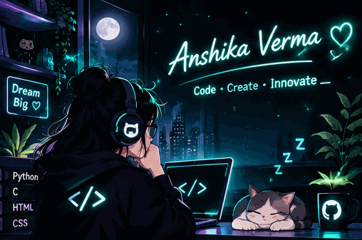

 <!-- ANSHIKA VERMA | GITHUB PROFILE README -->

---

## 👩‍💻 About Me

- 🎓 B.Tech Student at Army Institute of Technology, Pune
- 💼 Python Development Intern at UptoSkills
- 🐍 Interested in Python and Software Development
- 🌱 Currently exploring Web Development and AI
- 🚀 Building projects and learning through practical experience
- ✨ Believe in learning something new every day!

 

## 🛠️ Technologies I Know

## 🌱 Currently Learning

## 🔧 Tools I Use

---

## 🚀 Featured Project

### 🤖 UptoSkills AI Assistant

Currently collaborating on an AI-powered assistant project.

**Tech stack:** React.js · Node.js · Express.js · MongoDB · AI Integration

[View Project](https://github.com/anshika-63/uptoskills-ai-assistant)

### 💡 Other Projects

- [AI Duplicate Detection](https://github.com/anshika-63/AI-Duplicate-Detection) – Python-based duplicate file detection.
- [Public Space Acoustic Classification](https://github.com/anshika-63/Public-Space-Acoustic-Classification)

---

## 💻 Coding Profiles

---

## 📊 GitHub Statistics

---

## 🐍 Contribution Snake

---

## 🌐 Let's Connect

### ✨ A developer in progress, one commit at a time.

