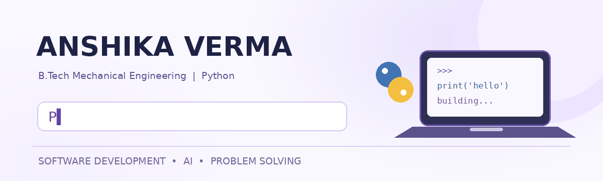

<!-- ✦ ANSHIKA VERMA | DEVELOPER PORTFOLIO -->

<div align="center">



<br/>


**B.Tech Student | Python Developer | Tech Explorer**

[](https://www.linkedin.com/in/anshika-verma-636z/)
[](https://github.com/anshika-63)

</div>

---

## `01` — About Me


Hey! I'm **Anshika**, a B.Tech student at Army Institute of Technology, Pune.

I'm passionate about technology, programming and building things that solve real problems.

- 🎓 B.Tech @ AIT Pune
- 💻 Python Development Intern @ UptoSkills
- 🐍 Exploring Python & problem solving
- 🌐 Learning Full Stack Web Development
- 🤖 Interested in AI & Machine Learning
- 🚀 Always ready to learn something new

<br clear="right"/>

---

## `02` — Tech Stack

<div align="center">

### Languages & Development


### Tools & Platforms


</div>

---

## `03` — Featured Projects

<div align="center">

<a href="https://github.com/anshika-63/AI-Duplicate-Detection">

</a>

<a href="https://github.com/anshika-63/Public-Space-Acoustic-Classification">

</a>

</div>

---

## `04` — GitHub Analytics

<div align="center">


<br/>


</div>

---

## `05` — My Coding Philosophy

<div align="center">

```python
class Developer:
    def __init__(self):
        self.name = "Anshika Verma"
        self.mindset = "Always Learning"
        self.goal = "Build Impactful Things"

    def daily_routine(self):
        return [
            "Learn something new",
            "Write some code",
            "Build cool projects",
            "Repeat 🔁"
        ]

me = Developer()
```

**Code. Create. Collaborate. Evolve.**

</div>

---

## `06` — Let's Connect

<div align="center">

<a href="https://www.linkedin.com/in/anshika-verma-636z/">

</a>

<a href="https://github.com/anshika-63">

</a>

<br/><br/>


*“The best way to predict the future is to build it.”* ✨

</div>

<!-- END OF PROFILE README -->
